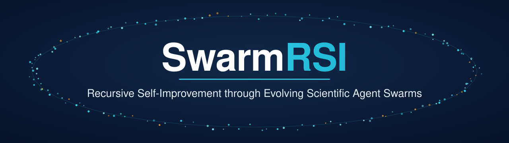
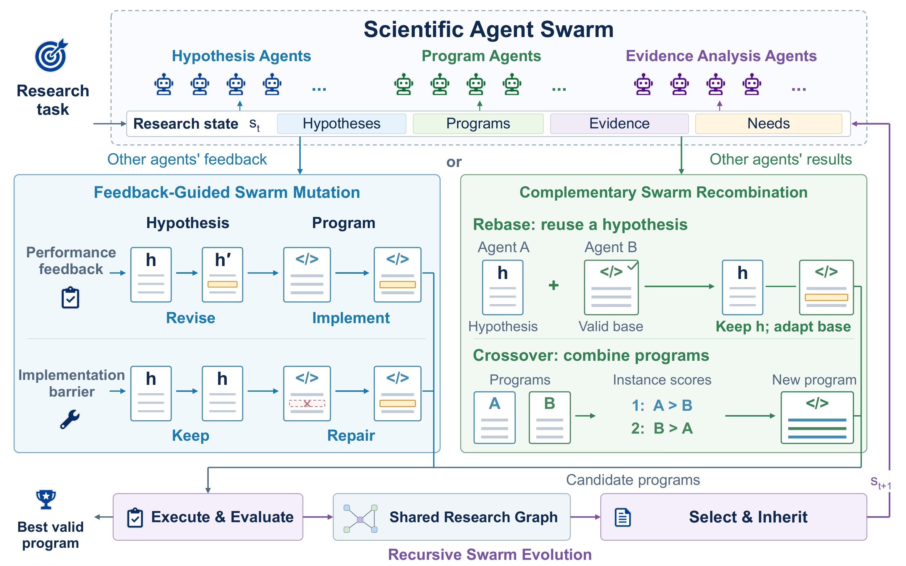
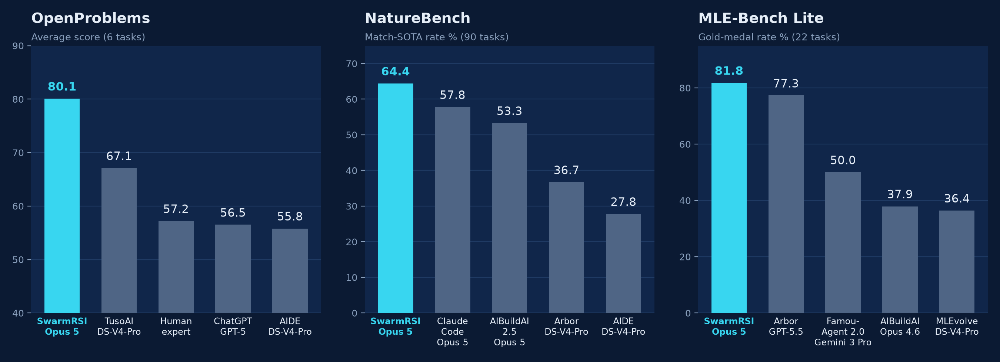

<p align="center">
  
</p>

<h1 align="center">SwarmRSI</h1>

<h3 align="center">A scientific agent swarm that improves its own research by evolving what its agents inherit</h3>

<p align="center">
  
  
  
  <a href="LICENSE"></a>
</p>

<p align="center">
  <i>Give SwarmRSI a research goal, a starter program and an evaluator. Its agents propose
  hypotheses, implement them, run real experiments, and write every outcome, including
  failures, into a <b>shared research graph</b> that later agents inherit.</i>
</p>

### 🏆 State-of-the-art results on all three benchmarks

| Benchmark | Metric | Strongest baseline | **SwarmRSI** (Claude Opus 5) |
| --- | --- | :---: | :---: |
| OpenProblems (6 single-cell tasks) | average score ↑ | 67.1 (TusoAI) | **80.1** |
| NatureBench (90 scientific coding tasks) | Match-SOTA % ↑ | 57.8 (Claude Code, Opus 5) | **64.4** |
| MLE-Bench Lite (22 competitions) | gold medal % ↑ | 77.3 (Arbor, GPT-5.5) | **81.8** |

With the same DeepSeek-V4-Pro backbone, SwarmRSI also exceeds Arbor by 7.8 pp and AIDE by 16.7 pp in NatureBench Match-SOTA. → [See full results](#-results)

## 🎬 Demo


https://github.com/user-attachments/assets/cc89beaf-a4e8-4dbf-b54e-226419f47691


## 💡 Why SwarmRSI

Scientific agent swarms explore many directions at once, but sharing experience does not
by itself make agents research better. Two things go wrong:

* **A failed experiment hides its cause.** A poor score does not say whether the
  hypothesis or its implementation was at fault, so promising ideas are abandoned.
* **A program without gains can still hold what another agent needs.** Useful
  components are discarded with programs that perform poorly overall.

SwarmRSI addresses both by evolving the **research states** agents inherit: hypotheses,
programs, experimental evidence and unresolved needs.

* **Feedback-Guided Swarm Mutation**: uses other agents' experimental feedback to decide
  whether to revise a hypothesis (**H-mutation**) or repair its program (**P-mutation**).
* **Complementary Swarm Recombination**: tests a retained hypothesis on another agent's
  program (**rebase**) and combines components from programs with complementary
  strengths across instances (**crossover**).
* **Recursive Swarm Evolution**: evaluates every candidate, returns each outcome to the
  shared graph, and uses a discounted-UCB index (**H/P selection**) to choose whether the
  next step revises a hypothesis or a program.

## 🧩 Framework

<p align="center">
  
</p>

Each step of the loop:

1. **Assemble**: the acting agent builds its research state from the shared graph,
   including other agents' results and unresolved needs.
2. **Select**: H/P selection decides whether to revise a hypothesis or a program.
3. **Mutate or recombine**: the agent applies H-mutation, P-mutation, rebase or crossover.
4. **Execute and audit**: the candidate runs under the task protocol; source and output
   checks confirm that the intended change was implemented.
5. **Write back**: the outcome, including failed and non-improving attempts, updates the
   shared graph and the needs that later agents act on.

## 📊 Results

<p align="center">
  
</p>

**OpenProblems** (normalized scores × 100, six-task average)

| Method | Backbone | Avg ↑ |
| --- | --- | :---: |
| Human expert | task-specific | 57.2 |
| ChatGPT | GPT-5 | 56.5 |
| AIDE | DeepSeek-V4-Pro | 55.8 |
| TusoAI | DeepSeek-V4-Pro | 67.1 |
| **SwarmRSI** | DeepSeek-V4-Pro | 74.2 |
| **SwarmRSI** | Gemini 3.1 Pro Preview | 76.2 |
| **SwarmRSI** | Claude Opus 5 | **80.1** |

**NatureBench** (all 90 tasks, %)

| Method | Backbone | Surpass-SOTA ↑ | Match-SOTA ↑ |
| --- | --- | :---: | :---: |
| AIDE | DeepSeek-V4-Pro | 10.0 | 27.8 |
| Arbor | DeepSeek-V4-Pro | 12.2 | 36.7 |
| Claude Code | Claude Opus 5 | 23.3 | 57.8 |
| AIBuildAI 2.5 | Claude Opus 5 | 23.3 | 53.3 |
| **SwarmRSI** | DeepSeek-V4-Pro | 15.6 | 44.4 |
| **SwarmRSI** | Gemini 3.1 Pro Preview | 14.4 | 44.4 |
| **SwarmRSI** | Claude Opus 5 | **28.9** | **64.4** |

**MLE-Bench Lite** (22 competitions, %)

| Method | Backbone | Above Median ↑ | Gold ↑ | Any Medal ↑ |
| --- | --- | :---: | :---: | :---: |
| MLEvolve | DeepSeek-V4-Pro | 81.8 | 36.4 | 72.7 |
| Arbor | DeepSeek-V4-Pro | 86.4 | 40.9 | 77.3 |
| Arbor | GPT-5.5 | **95.5** | 77.3 | **86.4** |
| Famou-Agent 2.0 | Gemini 3 Pro Preview | 93.9 | 50.0 | 80.3 |
| **SwarmRSI** | DeepSeek-V4-Pro | 90.9 | 45.5 | 81.8 |
| **SwarmRSI** | Gemini 3.1 Pro Preview | 86.4 | 40.9 | 81.8 |
| **SwarmRSI** | Claude Opus 5 | **95.5** | **81.8** | **86.4** |

SwarmRSI and rerun baselines report means over three seeds. See the paper for the full
tables, ablations and trajectory analyses.

## ⚡ Getting Started

### Install

Use Python 3.11 or 3.12. Candidate execution requires Linux and `bubblewrap`.

```bash
git clone <repository-url> SwarmRSI
cd SwarmRSI

python3.11 -m venv .venv
source .venv/bin/activate
python -m pip install -e '.[dev,openproblems,mlebench-insults]' pillow pyarrow

# Ubuntu / Debian
sudo apt-get install bubblewrap

python -m swarmrsi --help
```

The Python package and command-line interface use the name `swarmrsi`.

### Prepare the runtime and credentials

Create a separate scientific Python environment with the packages required by your benchmark tasks. For OpenProblems, install the provided requirements into that environment:

```bash
/absolute/science/bin/python -m pip install -r benchmarks/openproblems/requirements.txt
```

Set the path to that interpreter and your model credential:

```bash
export SCIENCE_PYTHON=/absolute/science/bin/python
export DEEPSEEK_API_KEY="your-api-key"
```

The examples below use the DeepSeek endpoint and the model configured in the supplied profiles. To use another backbone, update the profile's `model` and request settings, and pass its corresponding `--base-url`.

### Run a benchmark

#### NatureBench

Prepare the official NatureBench task packages, including public inputs, task descriptions, metadata, and evaluators. The profile contains all 90 task IDs and uses the included cold-start program. See [NatureBench setup](benchmarks/naturebench/README.md) for the expected layout.

```bash
export NB_TASKS_ROOT=/absolute/naturebench/tasks

# Check the task package and execution environment.
python -m swarmrsi run-naturebench \
  --profile config/naturebench/profile.json \
  --tasks-root "$NB_TASKS_ROOT" \
  --task-id s41467-025-63412-3 \
  --runtime-python "$SCIENCE_PYTHON" \
  --credential-env DEEPSEEK_API_KEY \
  --base-url https://api.deepseek.com/v1 \
  --seed 0 --run-dir "$PWD/runs/naturebench/example" --preflight

# Start the search.
python -m swarmrsi run-naturebench \
  --profile config/naturebench/profile.json \
  --tasks-root "$NB_TASKS_ROOT" \
  --task-id s41467-025-63412-3 \
  --runtime-python "$SCIENCE_PYTHON" \
  --credential-env DEEPSEEK_API_KEY \
  --base-url https://api.deepseek.com/v1 \
  --seed 0 --run-dir "$PWD/runs/naturebench/example"
```

Change `--task-id` and `--run-dir` for each experiment. Task budgets and execution settings are configured in `config/naturebench/profile.json`.

#### OpenProblems

The adapter supports six tasks: `denoise`, `label`, `batch`, `svg`, `decomp`, and `visual`.

Prepare a dataset manifest following [OpenProblems setup](benchmarks/openproblems/README.md), then build the task package:

```bash
python benchmarks/openproblems/build_package.py \
  --manifest /absolute/denoise-optimization.json \
  --destination data/openproblems/optimization/denoise

python -m swarmrsi run-naturebench \
  --profile config/openproblems/profile.json \
  --tasks-root data/openproblems/optimization \
  --task-id denoise \
  --runtime-python "$SCIENCE_PYTHON" \
  --credential-env DEEPSEEK_API_KEY \
  --base-url https://api.deepseek.com/v1 \
  --seed 0 --run-dir "$PWD/runs/openproblems/denoise" --preflight
```

After preflight succeeds, repeat the run command without `--preflight`. OpenProblems uses the shared `run-naturebench` execution interface. Build optimization and deployment packages separately; use deployment data only to evaluate the selected final program.

#### MLE-Bench Lite

Prepare the official MLE-Bench data and grader, then assemble a competition run. The 22 competition IDs are listed in [`lite22.txt`](benchmarks/mlebench/lite22.txt).

```bash
python deploy/mle/run_matched.py detecting-insults-in-social-commentary \
  --root "$PWD/runs/mlebench" \
  --prepared-root /absolute/prepared/data \
  --mlebench-data-dir /absolute/mlebench/registry \
  --official-source /absolute/mle-bench \
  --python "$SCIENCE_PYTHON" \
  --model deepseek-flash \
  --base-url https://api.deepseek.com/v1 \
  --seed 0 --internal-validation-policy controller_only
```

This generates a task package, profile, and run configuration. Set the generated configuration's credential source to your environment variable:

```bash
python - <<'PY'
import json
from pathlib import Path

path = Path("runs/mlebench/configs/detecting-insults-in-social-commentary.json")
config = json.loads(path.read_text())
config["model"]["api_key_file"] = None
config["model"]["api_key_env"] = "DEEPSEEK_API_KEY"
path.write_text(json.dumps(config, indent=2) + "\n")
PY

python -m swarmrsi preflight \
  --config runs/mlebench/configs/detecting-insults-in-social-commentary.json

python -m swarmrsi run \
  --config runs/mlebench/configs/detecting-insults-in-social-commentary.json
```

Configure resource limits and any offline model-cache paths for your machine before running. See [MLE-Bench setup](benchmarks/mlebench/README.md) for data preparation and official terminal grading.

### Inspect results

Search runs save candidate programs, evaluation records, and final reports under the chosen run directory.

```bash
python -m swarmrsi report --run /absolute/completed-run
```

NatureBench reports aggregate improvement over the reference method. OpenProblems reports task-specific scores. MLE-Bench uses public validation during search and official private-test grading for the final submission.

### Development

```bash
python -m pytest tests -q

# Six-task OpenProblems interface check
PYTHONPATH=src "$SCIENCE_PYTHON" benchmarks/openproblems/synthetic_smoke.py
```

| Directory | Contents |
|---|---|
| `src/swarmrsi/` | Search, planning, coding, execution, and evaluation |
| `config/` | Search settings, benchmark profiles, and starters |
| `benchmarks/` | Benchmark setup and OpenProblems task adapters |
| `deploy/mle/` | MLE-Bench task and run preparation |
| `baselines/` | Baseline integrations and setup |
| `tests/` | Regression tests |

## 🧪 Baselines

| Baseline | Benchmarks |
| --- | --- |
| [AIDE](https://github.com/WecoAI/aideml) | NatureBench, OpenProblems |
| [Arbor](https://github.com/RUC-NLPIR/Arbor) | MLE-Bench Lite, NatureBench |
| [MLEvolve](https://github.com/InternScience/MLEvolve) | MLE-Bench Lite |
| [TusoAI](https://github.com/Alistair-Turcan/TusoAI) | OpenProblems |

Fetch the pinned upstream revisions with `scripts/fetch_baseline.py` and install each
baseline's dependencies in its own environment:

```bash
python scripts/fetch_baseline.py aide
python scripts/fetch_baseline.py arbor
python scripts/fetch_baseline.py mlevolve
python scripts/fetch_baseline.py tusoai
```

See [Baseline setup](baselines/README.md) for the run commands.

## 🗂️ Project Structure

```
src/swarmrsi/      SwarmRSI search, planning, coding, execution and evaluation
config/            Search settings, benchmark profiles and starter programs
benchmarks/        Benchmark setup and OpenProblems task adapters
deploy/            MLE-Bench task preparation and NatureBench references
baselines/         Baseline integrations
scripts/           Baseline runners and utilities
tests/             Regression tests
```

## 📚 Citation

```bibtex
@misc{swarmrsi2026,
  title  = {SwarmRSI: Recursive Self-Improvement through Evolving Scientific Agent Swarms},
  author = {Anonymous Authors},
  year   = {2026},
  note   = {Under review}
}
```

## 📄 License

SwarmRSI is released under the [Apache-2.0 License](LICENSE). See
[Third-party notices](THIRD_PARTY_NOTICES.md) for dependency and upstream attribution.
